<p align="center">
  
</p>

<p align="center">
  <a href="https://github.com/username1puni/krishiconnect/actions/workflows/ci.yml"></a>
  
  
  
  
  
  
  <a href="LICENSE"></a>
</p>

<p align="center">
  <b><a href="https://krishiconnect.sites.tab.bot/">Live demo</a></b> &middot;
  <a href="https://krishiconnect.sites.tab.bot/swagger-ui.html">API docs (Swagger)</a> &middot;
  <a href="docs/postman/KrishiConnect.postman_collection.json">Postman collection</a> &middot;
  <a href="#how-double-booking-is-prevented">How double booking is prevented</a>
</p>

# KrishiConnect

KrishiConnect is a web app that connects farmers and rural residents with the farm machines and skilled
workers around them. A farmer opens the app, sees the tractors, harvesters, sprayers and drones closest to
their village sorted by **real road distance**, checks the availability calendar and books one by the
hour, day or acre. They can book a machine **together with a driver as one bundle**, or post a
requirement ("harvester needed for 3 acres of paddy next week") and let providers send quotations.

Most small farmers in India cannot buy a combine harvester or a rotavator, but someone in the next village
usually owns one that sits idle half the season. KrishiConnect is the marketplace in between, built to be
usable by people who are more comfortable in Kannada or Hindi than in English.

The core backend problem is the same one every rental system has: two farmers must never get the same
tractor for overlapping hours, even when they click "book" at the same moment. KrishiConnect solves it
with row locks inside a MySQL transaction plus a unique key on booked hourly slots, and proves it with
integration tests against a real MySQL server, including one where 20 farmers try to book overlapping
times on one tractor at once.

## Features

**For farmers (seekers)**
- Register and log in with a mobile number (JWT). Pick your village or use the phone's GPS.
- **Nearby machines and workers sorted by road distance** ("1.1 km by road, 2 min"), with a map view.
  If the routing service is slow or down, the list falls back to straight-line distance automatically.
- Machine details with photos, prices per **hour / day / acre**, reviews and a **4-week availability calendar**.
- **Bundle booking**: add a driver or operator to the same booking. Both are booked or neither is.
- **Requirements board**: post what you need, get quotations from providers and workers, accept one and
  a confirmed booking is created from it.
- **Seasonal tips**: based on your crops and the month (Karnataka crop calendar), the app suggests what
  you will need soon, for example a paddy transplanter in July or a combine harvester in November.
- My bookings with cancel, and **ratings and reviews** after the work is done.
- In-app **notifications** when a booking or quote is accepted, rejected or expires.

**For providers and specialists**
- Providers list machines with photos, location and prices; specialists (tractor drivers, harvester
  operators, spray operators, drone pilots, mechanics, coconut climbers, labour) set their skill, daily rate and availability.
- Incoming requests to accept or reject, mark work as done, send quotes on the requirements board.

**For admins**
- Dashboard: users per role, bookings by status, booked value per month, top categories and a
  **seasonal demand chart** (machine bookings per month by category).
- Verify providers and specialists, approve or hide listings, see all bookings.
- A switch to turn road distance off, which is handy to show the fallback working.

**Everywhere**
- Full **English, Kannada and Hindi** UI. The choice is saved on the account, so it follows you to another phone.
- REST API with pagination, validation and consistent error responses, documented with Swagger and a
  Postman collection.

## Screenshots

All screenshots are from the live demo.

| Nearby machines, sorted by road distance | Machine details, calendar and booking form |
|---|---|
| 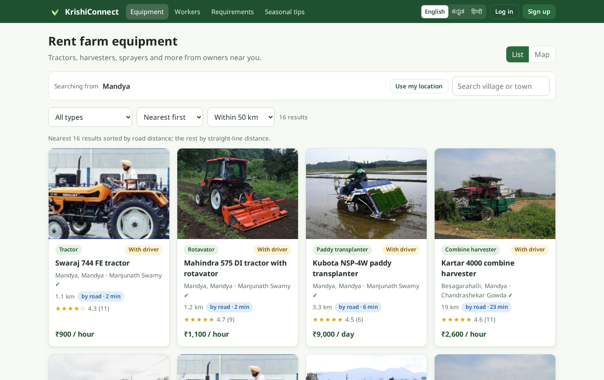 | 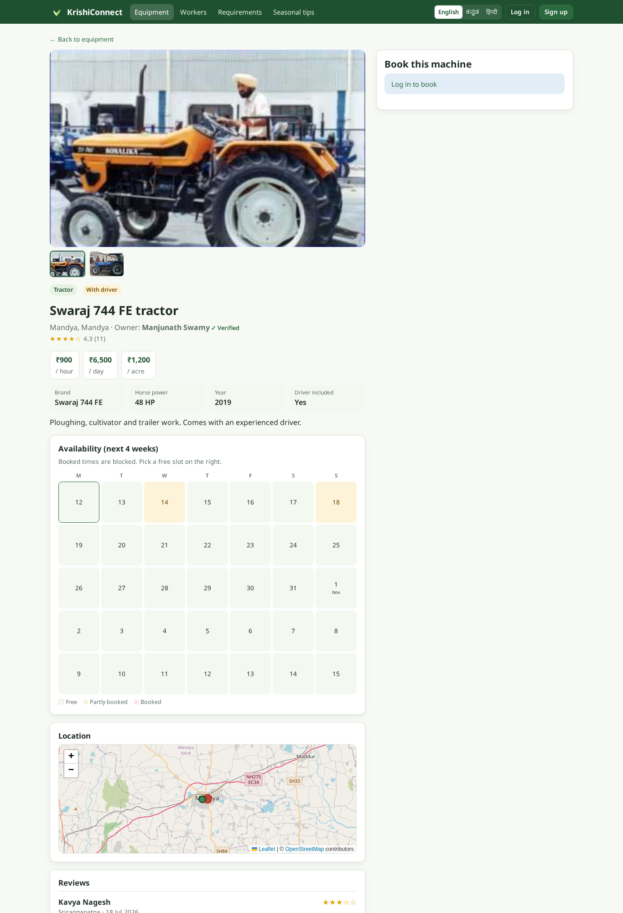 |

| Home in Hindi | Machine list in Kannada |
|---|---|
| 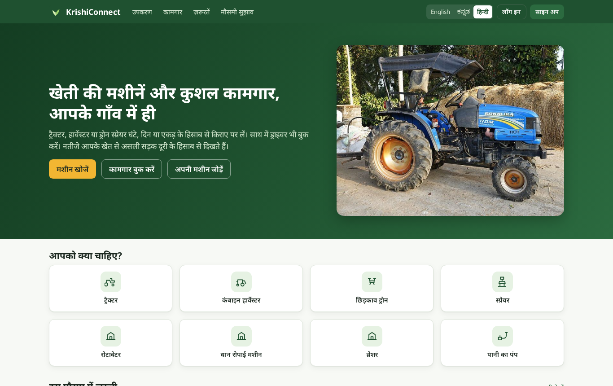 | 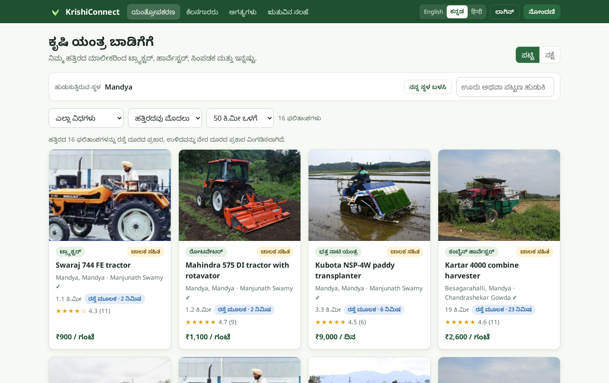 |

| Second farmer, overlapping hours: refused | Quote accepted, booking confirmed |
|---|---|
| 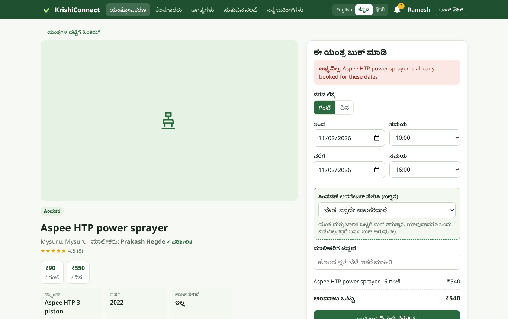 | 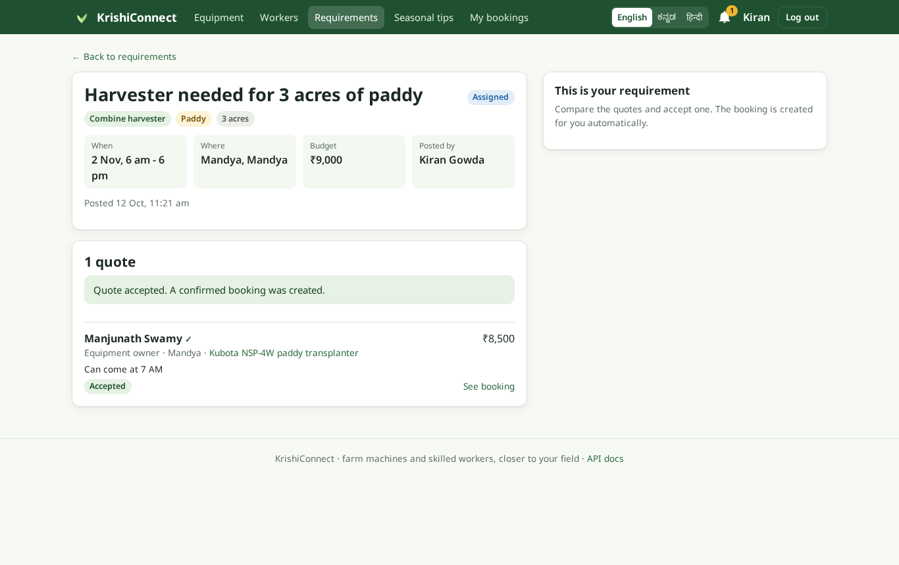 |

| Skilled workers nearby | Requirements board |
|---|---|
| 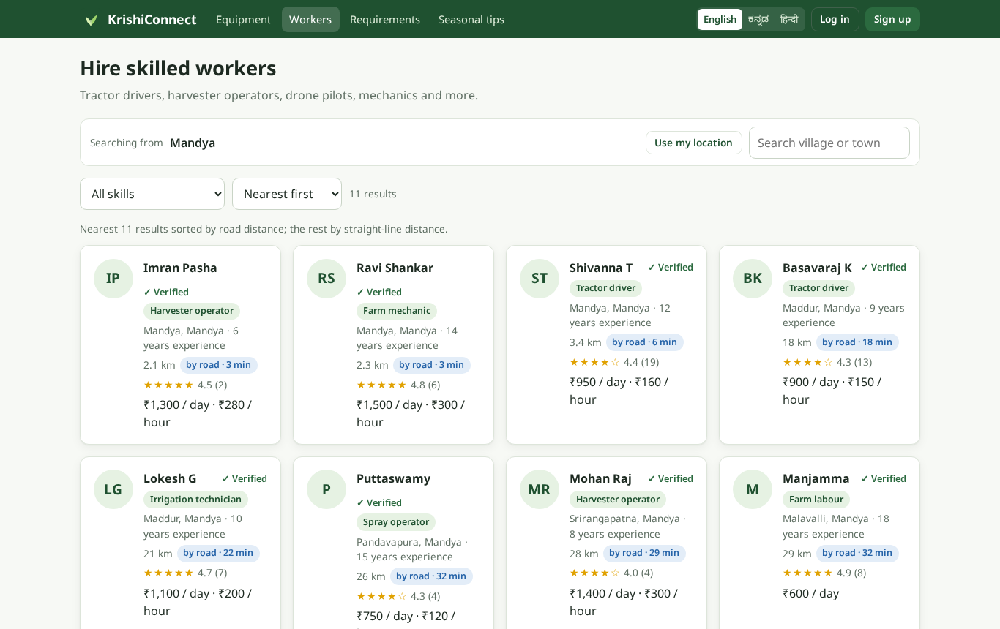 | 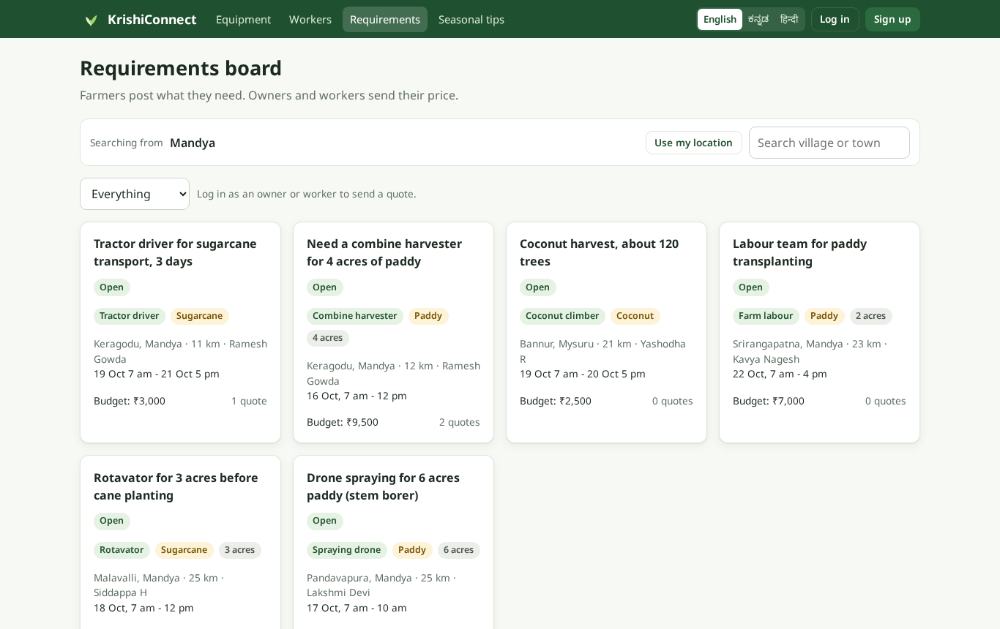 |

| Seasonal tips | Notifications |
|---|---|
| 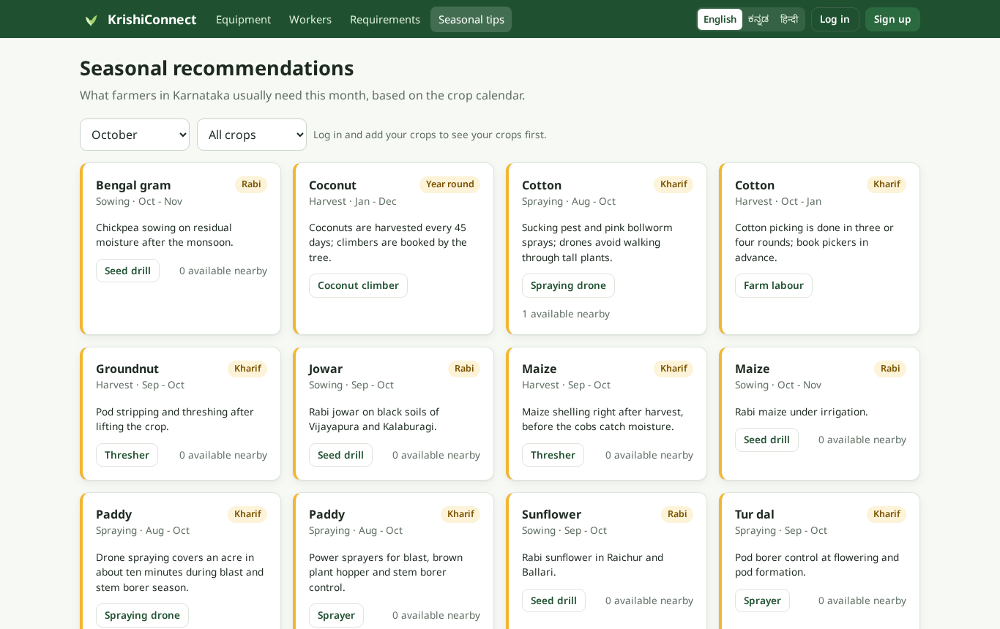 | 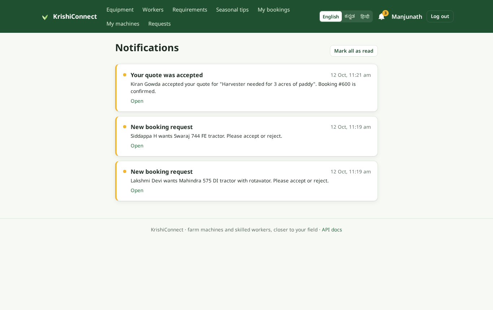 |

<p align="center">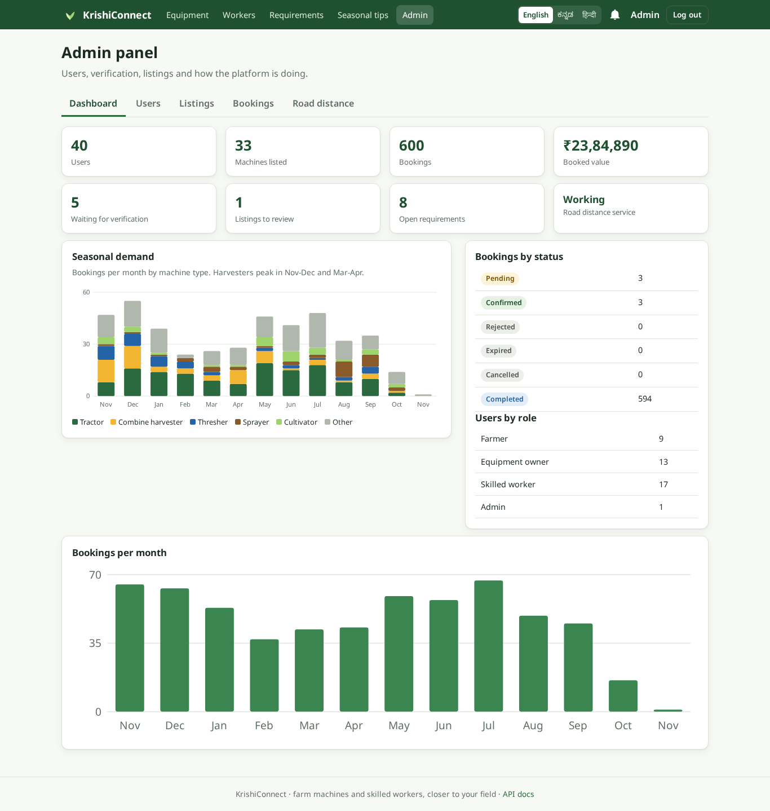</p>

## How double booking is prevented

A booking covers a time range (always on whole hours) and can contain more than one item, for example a
tractor and its driver. Two ranges on the same item overlap when `start1 < end2 AND start2 < end1`.
Checking that with a plain `SELECT` and then inserting is a race: two requests can both see the tractor as
free and both insert. KrishiConnect closes that gap in layers.

<p align="center">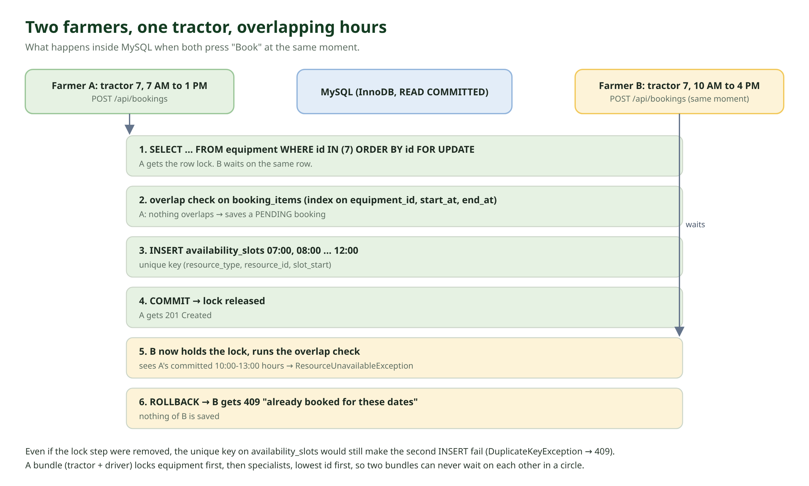</p>

1. **Lock the resource rows first.** `BookingService.reserve` runs in one transaction and starts with
   `SELECT ... FOR UPDATE` on the equipment rows and the specialist rows it needs. A second request for
   the same tractor waits on that lock until the first one commits or rolls back.
2. **Always lock in the same order.** Equipment before specialists, lowest id first. Two bundles that
   share machines can never hold locks in opposite orders, so they cannot deadlock. The lock queries touch
   only the rows being booked and do not join other tables, so they do not lock anything extra.
3. **Check the calendar while holding the lock.** For each item, an overlap query against active bookings
   (`PENDING` and `CONFIRMED`). It is answered from the composite index
   `(equipment_id, start_at, end_at, status)`.
4. **All or nothing.** If any item in a bundle is busy, the method throws before anything is written, and
   the whole transaction rolls back. The farmer gets `409 Conflict` with the names of the busy items.
5. **A unique key as the last line of defence.** Every booked hour is written to `booking_slots`, which
   has `UNIQUE (resource_type, resource_id, slot_start)`. Even if a code path ever skipped the lock, MySQL
   itself would reject the second insert. That exception, and a lock timeout, are both mapped to `409`
   instead of a `500`.
6. **Expiry releases slots.** A provider has 2 hours (configurable, and never past the start time) to
   accept a request. A scheduled job marks unanswered requests `EXPIRED`, deletes their slots and notifies
   the farmer, so a forgotten request does not block a machine for the season.

The concurrency tests in `BookingConcurrencyIT` run against MySQL 8.4 in Testcontainers:

| Test | Result |
|---|---|
| 20 farmers book overlapping hours on one tractor at the same moment | exactly 1 booking created, 19 get 409 |
| Back-to-back bookings (7 to 10 and 10 to 13) | both allowed, they do not overlap |
| Tractor + driver bundle where the driver is already busy | nothing booked, tractor stays free |
| Bundles and single bookings racing for the same driver | no deadlocks, exactly one winner per hour |
| Bundles locking two machines in reverse order | no deadlocks |
| Insert a clashing slot directly, skipping the service | rejected by the unique key |
| Booking in the past or not on the hour | rejected with 400 |

I also ran the race on the live demo: 10 newly registered farmers sent overlapping requests for the same
sprayer at the same instant, and the server answered one `201` and nine `409`.

## Road distance and the fallback

<p align="center">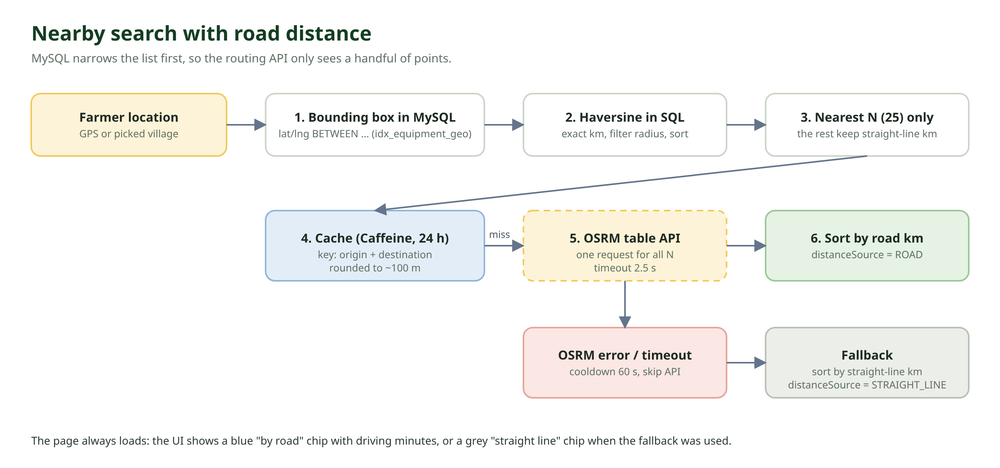</p>

Straight-line distance is misleading in villages: a tractor 3 km away across a river can be 15 km by road.
Calling a routing API for every machine in the state is too slow, so the search works in two steps:

1. **Pre-filter in MySQL.** A bounding box around the farmer (`latitude BETWEEN ? AND ? AND longitude
   BETWEEN ? AND ?`) uses the `(latitude, longitude)` index, then the haversine formula keeps only results
   inside the chosen radius and orders them by straight-line distance.
2. **Route only the nearest N** (25 by default) with one call to the OSRM table API, which returns road
   distance and driving time from the farmer to all of them at once. The list is then re-sorted by road distance.

Road answers are cached for a day per (rounded origin, destination) with Caffeine, so farmers in the same
village share them. If OSRM fails or takes longer than 2.5 s, the response uses straight-line distance and
says so (`distanceSource: STRAIGHT_LINE`), and the routing call is skipped for a short cool-down so every
search does not wait for the same timeout. The admin page shows API calls, failures, cache hits and has the
on/off switch.

## Database indexing

Every index exists for a query the app actually runs. The main ones:

| Index | Query it serves |
|---|---|
| `equipment (latitude, longitude)`, same on `users`, `places`, `requirements` | "near me" bounding box scan |
| `equipment (moderation_status, status, category, created_at)` | browse page without a location: approved, active, by category, newest first |
| `booking_items (equipment_id, start_at, end_at, status)` and the same for `specialist_id` | the overlap check under the lock, and the availability calendar |
| `booking_slots UNIQUE (resource_type, resource_id, slot_start)` | the database-level double booking guarantee |
| `bookings (status, expires_at)` | the expiry job: pending bookings past their deadline |
| `bookings (seeker_id, created_at)` | "my bookings", newest first, paginated |
| `booking_items (provider_id, status)` | a provider's incoming requests |
| `notifications (user_id, is_read, created_at)` | unread count and the notification list |
| `quotes UNIQUE (requirement_id, provider_id)` | one quote per provider per requirement |
| `reviews UNIQUE (booking_item_id)` | one review per completed booking item |

All list endpoints are paginated (`page`, `size`), and lazy associations of a page of bookings are loaded
with batch fetching, not one query per row.

## Architecture

<p align="center">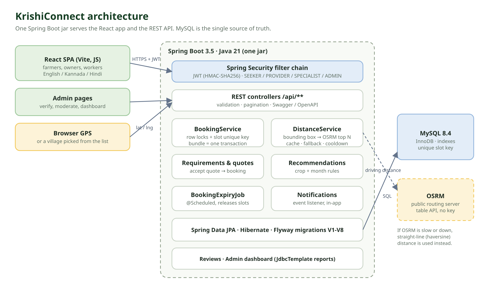</p>

A single Spring Boot application serves the REST API and the built React app. MySQL holds everything,
including machine photos. Flyway owns the schema. Notifications are written by an event listener inside the same
transaction as the booking change, so a booking that rolls back never leaves a notification behind.

Booking states: `PENDING` (waiting for the provider) → `CONFIRMED` (every item accepted) → `COMPLETED`,
or `REJECTED`, `CANCELLED`, `EXPIRED`. A booking created from an accepted quote starts as `CONFIRMED`.

### Database

<p align="center">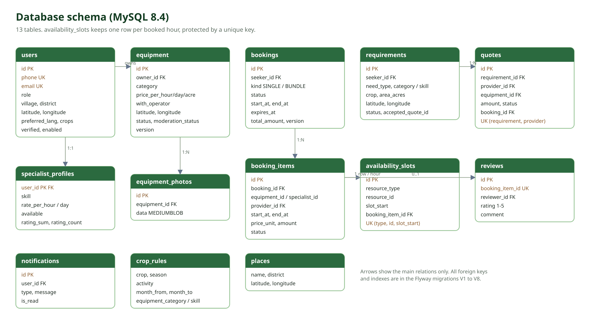</p>

## Tech stack

| Layer | Technology |
|---|---|
| Backend | Java 21, Spring Boot 3.5, Spring Security, Spring Data JPA, Bean Validation |
| Auth | JWT (jjwt), BCrypt, roles `SEEKER`, `PROVIDER`, `SPECIALIST`, `ADMIN` |
| Database | MySQL 8.4, Flyway migrations |
| Location | Browser geolocation, OSRM table API, haversine fallback, Caffeine cache |
| Frontend | React 19, Vite, React Router, react-i18next, Leaflet maps, plain CSS |
| Testing | JUnit 5, Testcontainers (MySQL), Vitest + Testing Library, Postman |
| Build and deploy | Maven, Docker, docker-compose, GitHub Actions |

## Run it locally

### With Docker (easiest)

```bash
git clone https://github.com/username1puni/krishiconnect.git
cd krishiconnect
cp .env.example .env        # then change the passwords and JWT_SECRET
docker compose up --build
```

Open http://localhost:8080. With `SEED_DEMO_DATA=true` the database is filled with villages around
Mandya, Mysuru and other Karnataka districts, 33 machines, 16 workers, requirements and past bookings.
Demo accounts (password from `DEMO_PASSWORD`, `demo1234` by default):

| Role | Mobile |
|---|---|
| Farmer | 9900000001 |
| Provider | 9900000002 |
| Specialist | 9900000003 |

The admin account is created from `ADMIN_EMAIL` and `ADMIN_PASSWORD`.

### Without Docker

You need Java 21, Node 20+ and MySQL 8.

```bash
# database
mysql -u root -p -e "CREATE DATABASE krishiconnect; CREATE USER 'krishi'@'%' IDENTIFIED BY 'krishi'; GRANT ALL ON krishiconnect.* TO 'krishi'@'%';"

# backend (http://localhost:8080)
cd backend
ADMIN_EMAIL=admin@example.com ADMIN_PASSWORD=admin1234 SEED_DEMO_DATA=true ./mvnw spring-boot:run

# frontend dev server (http://localhost:5173), in another terminal
cd frontend
npm install
npm run dev
```

## API

Swagger UI: `/swagger-ui.html`. A Postman collection with example requests for every role is in
[`docs/postman`](docs/postman/KrishiConnect.postman_collection.json); the login requests save tokens into
collection variables. The main endpoints:

| Area | Endpoints |
|---|---|
| Auth | `POST /api/auth/register`, `POST /api/auth/login` |
| Profile | `GET/PUT /api/users/me`, `PUT /api/users/me/language`, `PUT /api/users/me/specialist` |
| Machines | `GET /api/equipment?lat=&lng=&radiusKm=&category=&sort=distance`, `GET /api/equipment/{id}`, `GET /api/equipment/mine`, `POST/PUT /api/equipment`, `PATCH /api/equipment/{id}/status`, `POST/DELETE /api/equipment/{id}/photos` |
| Workers | `GET /api/specialists?lat=&lng=&skill=`, `GET /api/specialists/{id}` |
| Availability | `GET /api/equipment/{id}/availability`, `GET /api/specialists/{id}/availability` |
| Places | `GET /api/places?q=`, `GET /api/places/nearest?lat=&lng=` |
| Bookings | `POST /api/bookings`, `GET /api/bookings`, `GET /api/bookings/{id}`, `POST /api/bookings/{id}/cancel` |
| Provider | `GET /api/provider/bookings`, `POST /api/provider/bookings/items/{itemId}/accept`, `/reject`, `/complete` |
| Requirements and quotes | `GET/POST /api/requirements`, `GET /api/requirements/{id}`, `POST /api/requirements/{id}/quotes`, `POST /api/requirements/{id}/quotes/{quoteId}/accept`, `POST /api/requirements/{id}/close`, `GET /api/quotes/mine`, `POST /api/quotes/{id}/withdraw` |
| Reviews | `POST /api/reviews`, `GET /api/equipment/{id}/reviews`, `GET /api/specialists/{id}/reviews` |
| Notifications | `GET /api/notifications`, `GET /api/notifications/unread-count`, `POST /api/notifications/{id}/read`, `POST /api/notifications/read-all` |
| Recommendations | `GET /api/recommendations?month=&crop=`, `GET /api/recommendations/crops` |
| Admin | `GET /api/admin/dashboard`, `GET /api/admin/users`, `PATCH /api/admin/users/{id}/verify`, `GET /api/admin/equipment`, `PATCH /api/admin/equipment/{id}/moderation`, `GET /api/admin/bookings`, `GET/PUT /api/admin/routing` |

Errors always come back as JSON with a status and a readable message, for example
`409 {"message": "Aspee HTP power sprayer is already booked for these dates"}`.

## Project structure

```
backend/
  src/main/java/com/krishiconnect/
    config/       security, CORS, clock, seed data
    controller/   REST controllers
    dto/          request and response records
    entity/       JPA entities and enums
    exception/    error handling, 404 / 409 mapping
    location/     haversine, OSRM client, distance service with cache and fallback
    repository/   Spring Data repositories, lock and overlap queries
    security/     JWT filter and service
    service/      bookings, slots, expiry job, quotes, notifications, recommendations, reviews, admin
  src/main/resources/db/migration/   Flyway scripts V1 to V8
frontend/
  src/pages/      one file per screen
  src/components/ calendar, booking form, map, cards, language switcher
  src/locales/    en, kn, hi translations
docs/
  images/         diagrams and screenshots
  postman/        Postman collection
```

## Testing

```bash
cd backend && ./mvnw verify      # needs Docker for Testcontainers
cd frontend && npm test
```

| Suite | Tests | What it covers |
|---|---|---|
| Unit (JUnit) | 19 | haversine and bounding box, distance service fallback and cache, pricing per hour/day/acre, crop rules, JWT |
| Integration, real MySQL (Testcontainers) | 33 | concurrency (7), booking lifecycle and expiry (8), auth and API errors (8), nearby search (5), quotes (4), reviews (1) |
| Frontend (Vitest) | 17 | translations complete in all 3 languages, formatting, components |

CI runs all of them on every push, plus lint, the production build and a Docker image build.

## Limitations

Being honest about what this is and is not:

- **No online payment.** A booking records the price (hour, day or acre rate, or the accepted quote), and
  payment is settled between the farmer and the provider. There is no payment gateway, mock or real.
- **The public OSRM demo server** is used for road distance. It needs no key but is rate limited and has no
  uptime guarantee; for real traffic you would run your own OSRM with the India map. The straight-line
  fallback means the app keeps working when it is down.
- **Phone numbers are not verified by OTP.** Providers and specialists are verified by an admin instead.
- **Notifications are in-app only**, checked every 20 seconds. No SMS, WhatsApp or push notifications.
- **Photos are stored in MySQL.** Simple and fine for a demo; object storage would be the next step.
- **Bookings are on whole hours.** Acre pricing is an estimate entered by the farmer, not measured.
- Only the UI is translated. Text typed by users, like machine names, is shown as written.
- **The live demo** reseeds its data when the server restarts, so bookings made there do not last.

## License

[MIT](LICENSE)
